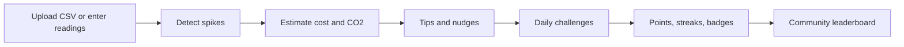
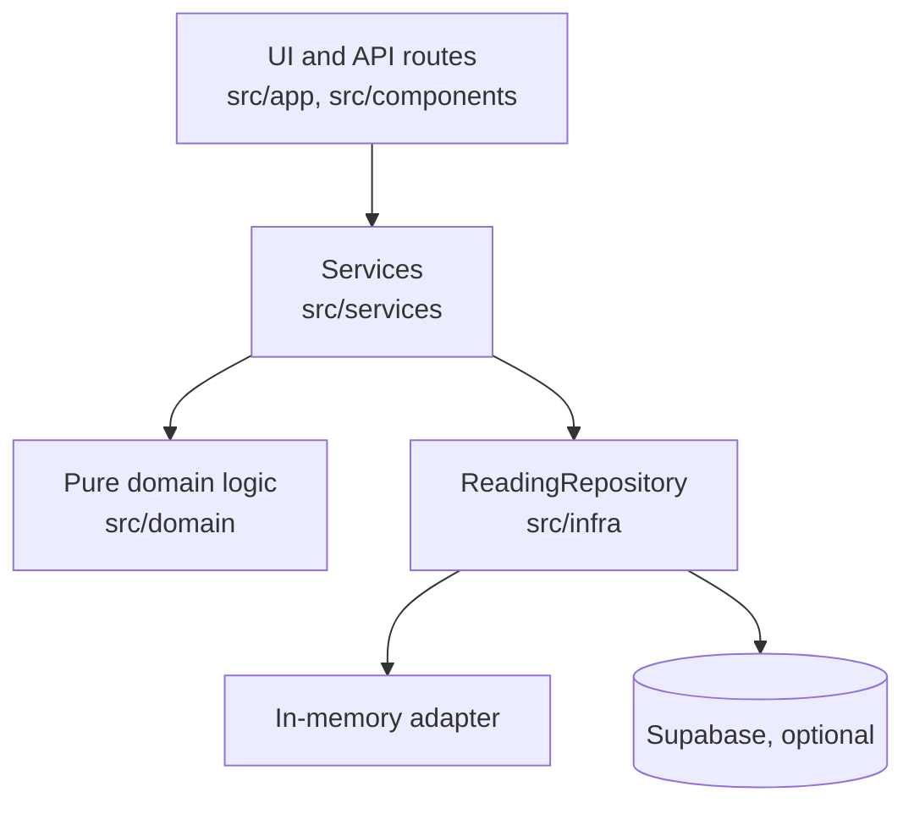

# WattWise ⚡

> **Know where your power goes.** Track household electricity, spot unusual usage, and build greener habits together.
>
> Inspired by India's Mission LiFE (Lifestyle for Environment).

[Live site](https://wattwise1.vercel.app) · [Demo video](https://youtu.be/IVb6-s5IYY0) · [Pitch deck](https://drive.google.com/file/d/10yDwcKXoYrzB7atVmvlMpK2HKk5bLE4Z/view) · [Full report](docs/REPORT.md)

## Why WattWise

Monthly bills can hide daily usage patterns, appliance costs, and estimated carbon impact. WattWise helps make those patterns easier to understand and act on.

## Features

- **Tracker:** CSV or manual readings, usage chart, spike detection, cost (₹) and CO₂ estimates
- **What-if calculator:** projected savings from habit changes
- **Nudges and challenges:** appliance tips and daily micro-tasks
- **Community:** points, streaks, badges, goals, and a leaderboard ranked by reduction from baseline
- **Admin:** aggregate-only regional view
- **Solar planner:** planning estimates from your monthly bill and roof area, plus official links and a rooftop assessment checklist

## How it works



## Architecture

Layered: no layer imports from a layer above it. Without Supabase credentials, an in-memory adapter keeps the demo working.



## Try it

1. Open the [live site](https://wattwise1.vercel.app) and click **Load Sample Data & View Dashboard**.
2. The 30-day sample flags **2 spike days**.
3. Move a **What-If** control, or upload your own CSV (`date,kwh`).
4. On `/community`, use **Load demo communities** to preview clearly labelled synthetic community data.

## Run locally

Node.js 22 or newer (see the `engines` field in `package.json`).

```bash
git clone https://github.com/harsh773988/Wattwise.git
cd Wattwise
npm ci
npm run dev    # http://localhost:3000
```

No environment file is required for local development; without Supabase credentials, the app uses in-memory storage, which resets when the server restarts. To configure optional integrations, copy `.env.example` to `.env.local` and fill only the settings you use:

- **Supabase persistence:** set valid Supabase URL and key values, then apply `supabase/schema.sql` followed by `supabase/20261031_challenge_completions.sql` and `supabase/20261101_gamification_community.sql`.
- **Administrator view:** set a strong server-side `ADMIN_KEY`; never expose it as a `NEXT_PUBLIC_` variable. The `/admin` page is a shared-key demo gate, not role-based authentication.
- **Contact email:** configure `RESEND_API_KEY` and `RESEND_FROM_EMAIL` to deliver contact-form submissions. Without them, the form runs in demo mode.
- **Analytics:** set `NEXT_PUBLIC_GA_ID` to enable Google Analytics.

## Tests

`npm test` · `npm run typecheck` · `npm run lint` · `npm run test:coverage`

## Tech stack

Next.js, React 19, TypeScript, Tailwind, Recharts, PapaParse, Zod, Supabase (optional), Vitest, GitHub Actions, Vercel.

## Limitations

- Peak hours (18:00–22:00) are an assumption. The app uses daily readings, not hourly meter data.
- Demo communities are synthetic and labelled *Demo data*.
- Baselines may be estimates until configured; challenge completions are self-reported and capped.
- No resident login. `/admin` uses a shared key as a demo gate only.
- `/solar` provides planning estimates from configurable assumptions, with no subsidy included; the cost per kW is a placeholder, not a quotation, and there is no vendor directory yet.
- Tariff and emissions factors are configurable estimates, not authoritative local values.

## Roadmap

Resident accounts and roles · hourly smart-meter nudges · DISCOM tariff slabs · push notifications · verified solar vendor directory
