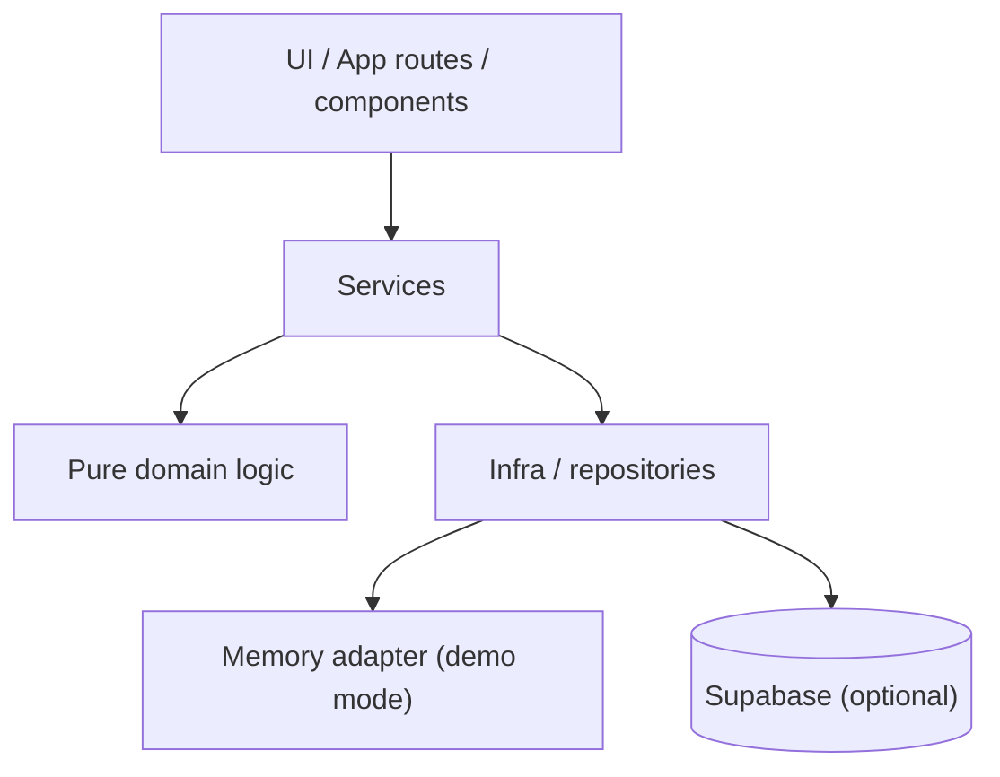

# WattWise ⚡

WattWise is a pan-India household energy intelligence platform built around India’s Mission LiFE goals and the national push for rooftop solar adoption. It helps households understand their electricity use, scan utility bills, model savings, and participate in greener daily habits through a gamified community experience.

> Live demo: [wattwise1.vercel.app](https://wattwise1.vercel.app)  
> Report: [docs/REPORT.md](docs/REPORT.md)

## Why this project exists

Most households only see a summary bill, not the actual load curve, appliance impact, time-of-day cost patterns, or the carbon intensity of the grid. WattWise translates utility data into plain-English action items and localized insights for Indian households, including:

- tariff analysis by DISCOM and slab
- solar-hour optimization and peak-shaving guidance
- EV vs petrol cost comparisons
- green challenge tracking and citizen passports
- state-wise benchmarking and community mapping

## Key capabilities

- Indian bill OCR and PDF parsing for major DISCOMs, with in-browser scanning and 1-click test presets
- Grid stress and solar timing dashboard using IST and carbon intensity cues
- PM Surya Ghar subsidy and ROI modeling for rooftop solar adoption
- EV charging comparisons for 2-wheelers, 3-wheelers, and 4-wheelers
- Multi-language support for English, Hindi, Gujarati, Marathi, Kannada, and Tamil
- Mission LiFE challenge system across 7 sustainability themes
- Community leaderboard and state-level conservation map
- CSV/manual input support for usage tracking
- Demo mode that works without any external services

## Architecture overview

This project keeps pure business logic separate from the UI and integrations.



Core logic is intentionally isolated from framework and external I/O dependencies so that calculations such as tariff modeling, solar ROI, and challenge scoring remain predictable and testable.

## Project structure

```text
.
├── public/                    # Static assets, icons, sample data, OCR assets
├── scripts/                  # Setup and generation scripts
├── src/
│   ├── app/                  # Next.js App Router pages and API routes
│   ├── components/           # UI components
│   ├── domain/               # Business logic and domain models
│   ├── infra/                # Repositories / storage adapters
│   ├── lib/                  # Shared utilities and environment config
│   └── ...
├── supabase/                 # SQL schema and migration files
├── tests/                    # Test helpers / coverage setup
├── .env.example              # Template environment file
├── docs/REPORT.md            # Product report and background
├── package.json              # Scripts and dependency metadata
├── next.config.ts            # Next.js configuration
├── tsconfig.json             # TypeScript setup
├── vitest.config.ts          # Test configuration
├── sample_data.csv           # Sample household usage data
├── README.md                 # Project documentation
└── ...
```

## Tech stack

- Next.js 16 (App Router)
- React 19
- TypeScript 5
- Tailwind CSS v4
- Recharts
- PapaParse
- zod
- Tesseract.js for OCR
- Supabase (optional, for auth and persistent data)
- Vitest for automated tests

## Requirements

- Node.js 22 or newer
- npm
- Optional: Supabase project for user auth and persistent storage

## Quick start

```bash
git clone https://github.com/harsh773988/Wattwise.git
cd Wattwise
npm install
cp .env.example .env.local
npm run dev
```

Then open http://localhost:3000.

## Environment variables

The project has a demo mode that works without any environment variables, but for production or full Supabase features, configure your local `.env.local` using the template in [.env.example](.env.example).

### Required for demo mode

None. The app falls back to the in-memory repository when Supabase credentials are absent.

### Optional but recommended

| Variable | Required | Purpose |
| --- | --- | --- |
| `NEXT_PUBLIC_SUPABASE_URL` | No | Supabase project URL for browser auth and client access |
| `NEXT_PUBLIC_SUPABASE_ANON_KEY` | No | Browser-safe anonymous key |
| `SUPABASE_SERVICE_ROLE_KEY` | No | Server-only key for private repository access |
| `NEXT_PUBLIC_SITE_URL` | No | Canonical site URL used for metadata, sitemaps, and crawlers |
| `NEXT_PUBLIC_GA_ID` | No | Google Analytics measurement ID |
| `CONTACT_EMAIL` | No | Email address used by the contact form |
| `RESEND_API_KEY` | No | API key for transactional email delivery |
| `RESEND_FROM_EMAIL` | No | Sender address for email notifications |
| `ADMIN_KEY` | No | Shared admin header key for the aggregate-only admin summary endpoint |
| `RATE_LIMIT_MAX` | No | Rate limit cap for API protection |
| `RATE_LIMIT_WINDOW_MS` | No | Time window for rate limiting |

Important notes:

- `SUPABASE_SERVICE_ROLE_KEY` must never be exposed as a `NEXT_PUBLIC_` variable.
- If Supabase is not configured, the app automatically runs in demo mode.
- The app validates env variables at startup and falls back to safe defaults when they are absent or incomplete.

## Supabase setup

If you want sign-in, saved readings, challenge completions, or authenticated home spaces, configure Supabase.

1. Create a new Supabase project.
2. Copy `.env.example` to `.env.local` and fill in the keys.
3. Run these database files in order:

```bash
supabase/schema.sql
supabase/20261031_challenge_completions.sql
supabase/20261101_gamification_community.sql
supabase/20261110_auth_ownership.sql
```

4. Enable email auth in Supabase Authentication settings.
5. Add your redirect URLs, including:

```text
http://localhost:3000/auth/callback
```

and any production callback URLs you use.

6. Restart the dev server and visit `/login`.

## Common scripts

```bash
npm run dev              # start development server
npm run build            # production build
npm run start            # serve production build
npm run lint             # lint the project
npm run typecheck        # TypeScript validation
npm test                 # run vitest suite
npm run test:watch       # watch mode for tests
npm run test:coverage    # coverage report
npm run seed:demo-communities  # seed demo community fixtures
```

The app includes a `predev` and `prebuild` script that copies local OCR assets before starting or building.

## Local usage walkthrough

1. Open the home page and try the bill scanner.
2. Use one of the preset DISCOM bill examples or upload a supported bill.
3. Inspect usage analysis, tariff modeling, and grid stress insights.
4. Open the dashboard to experiment with solar-hour scheduling.
5. Visit `/solar` to estimate PM Surya Ghar savings and ROI.
6. Explore `/challenges` for Mission LiFE quests and daily actions.
7. Visit `/community` to see state-level competitive progress.

## Testing and validation

Run the project checks before shipping changes:

```bash
npm test
npm run typecheck
npm run lint
```

## Deployment notes

This project is designed for deployment on Vercel, but the app can be run on any Next.js host that supports Node.js 22+.

Recommended deployment checklist:

- set `NEXT_PUBLIC_SITE_URL` to your production domain
- set the same Supabase variables used locally
- enable your production auth callback URL in Supabase
- configure `ADMIN_KEY` if you plan to use the protected admin summary endpoint
- verify OCR assets are available in the deployment environment

## Troubleshooting

### OCR or PDF parsing does not work

- ensure the local OCR assets have been copied by the prep scripts
- verify the file is within the supported size limits
- try the built-in sample presets first to validate the flow

### Supabase auth is not working

- confirm both public and service-role env keys are configured
- check the callback URL list in Supabase Auth
- restart the dev server after editing `.env.local`

### App keeps running in demo mode

This usually means the project is missing `NEXT_PUBLIC_SUPABASE_URL` and `SUPABASE_SERVICE_ROLE_KEY` or the values are incomplete.

## Contributing

Contributions are welcome. If you want to work on the app:

1. fork the repo
2. create a feature branch
3. make focused changes with tests where relevant
4. run the validation commands above
5. open a pull request with a clear description

## Additional resources

- [docs/REPORT.md](docs/REPORT.md)
- [Live site](https://wattwise1.vercel.app)
- [Demo video]()
- [Pitch deck](https://drive.google.com/file/d/1faT4isd3kZc0pYzlbUZ7sTWLsTXVVezr/view?usp=sharing)
