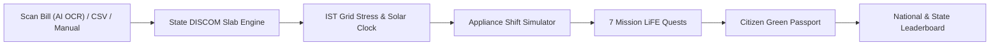
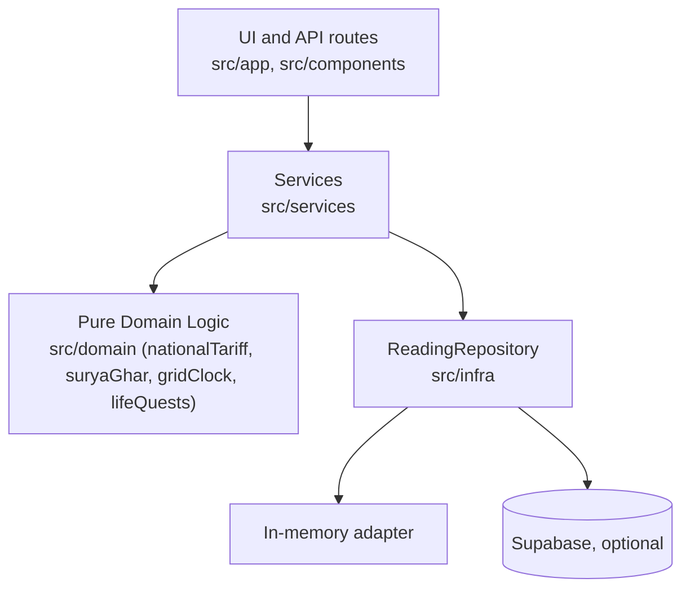

# WattWise ⚡ (Pan-India Mission LiFE Platform)

> **Know where your power goes.** Track household electricity across all 28 Indian States & 8 Union Territories, time energy use with the National Solar Grid Clock, scan any DISCOM bill via AI, and build greener habits together.
>
> Aligned with India's **Mission LiFE** (Lifestyle for Environment) and the Central **PM Surya Ghar: Muft Bijli Yojana**.

[Live site](https://wattwise1.vercel.app) · [Demo video](https://youtu.be/IVb6-s5IYY0) · [Pitch deck](https://drive.google.com/file/d/10yDwcKXoYrzB7atVmvlMpK2HKk5bLE4Z/view) · [Full report](docs/REPORT.md)

## Why WattWise (Pan-India)

Monthly utility bills hide hourly load curves, appliance drain, and real carbon intensity. WattWise translates raw consumption into actionable, localized insights across Indian state DISCOMs and connects everyday household behavior with national grid decarbonization.

## Core Capabilities

- 📷 **Universal Indian Bill Scanner:** In-browser OCR and PDF text extraction for major DISCOMs (MSEDCL, BSES Delhi, GUVNL DGVCL, BESCOM, UPPCL, TANGEDCO, CESC, etc.), with camera capture and 1-click test presets. Bill contents are not uploaded; English OCR assets may download on first use. Supports files up to 12 MB and PDFs up to 3 pages.
- 🕒 **National Grid Stress & Solar Clock:** Real-time Indian Standard Time (IST) dial tracking CEA carbon intensity, Green Solar Hours (10:00–16:00), Evening Peak (18:00–22:00), and an interactive Appliance Solar Shift simulator.
- ☀️ **PM Surya Ghar 360° Studio:** Official Government of India solar subsidy calculator (up to ₹78,000 Central + State Top-Ups) with 25-year cumulative financial ROI and DISCOM net-metering export revenue.
- 🛵 **EV Charging vs Petrol Calculator:** Sustainable mobility simulator for electric 2-wheelers, 3-wheelers, and 4-wheelers comparing home charging costs (₹0.24/km) with petrol (₹2.30/km) and solar daytime charging synergies.
- 🌐 **Pan-India Bhasha Support:** Built-in regional language switcher supporting English, Hindi (हिंदी), Gujarati (ગુજરાતી), Marathi (मराठी), Kannada (ಕನ್ನಡ), and Tamil (தமிழ்).
- 🌱 **7 Mission LiFE Quest Hub & Green Passport:** Daily action quests spanning all 7 national themes (Energy, Water, Plastic, Food, Waste, Lifestyle, E-Waste) with photo evidence upload and verifiable digital citizen passports.
- 🇮🇳 **Pan-India Champions Map:** Interactive leaderboard comparing state conservation indices across all 28 states & 8 UTs with municipal/district drilldowns.
- 📊 **Tracker & Spike Detection:** 30-day usage trends, spike detection (>25% over rolling baseline), and authentic telescopic slab cost modeling.
- 🏛️ **State Designated Agency (SDA) Command Center:** Multi-tier executive dashboard for energy planners tracking peak demand shaved (MW) and coal burning avoided.

## How it works



## Architecture

Strictly layered architecture: pure domain logic has **zero framework or I/O dependencies**. Without Supabase credentials, the in-memory adapter keeps the entire demo fully functional offline.



## Try it

1. Open the [live site](https://wattwise1.vercel.app).
2. Click **Scan Indian Bill (AI OCR)** and try any 1-click preset (e.g. *Delhi BSES*, *Mumbai MSEDCL*, *Gujarat DGVCL*, *Bengaluru BESCOM*, or *UP UPPCL*).
3. Check the **National Grid Stress Clock** on `/dashboard` to see current IST grid carbon intensity and test shifting appliances to Green Solar Hours.
4. Visit `/solar` to calculate your **PM Surya Ghar** subsidy and 25-year payback.
5. Visit `/challenges` to complete quests across the **7 Mission LiFE Themes** and view your **Citizen Green Passport**.
6. Visit `/community` to inspect the **Pan-India Green Champions Map**.

## Run locally

Node.js 22 or newer.

```bash
git clone https://github.com/harsh773988/Wattwise.git
cd Wattwise
npm ci
npm run dev    # http://localhost:3000
```

### Enable accounts

WattWise demo mode works without accounts or Supabase. To enable email/password sign-up and sign-in:

1. Create a Supabase project and set `NEXT_PUBLIC_SUPABASE_URL`, `NEXT_PUBLIC_SUPABASE_ANON_KEY`, and the server-only `SUPABASE_SERVICE_ROLE_KEY` in `.env.local`.
2. For a new database, run `supabase/schema.sql`, then the migrations `20261031_challenge_completions.sql`, `20261101_gamification_community.sql`, and `20261110_auth_ownership.sql` in that order. For an existing installation, apply `20261110_auth_ownership.sql`. It adds per-user home spaces and owner-scoped access to readings, challenge completions, and points.
3. In Supabase Authentication settings, enable email sign-ups and add `http://localhost:3000/auth/callback` (and your production callback URL) to the allowed redirect URLs.
4. Restart the dev server and visit `/login`.

The service-role key is for server-side data access only and must never be exposed in a `NEXT_PUBLIC_` variable. Existing unowned demo spaces are not automatically assigned to a new account.

## Tests

```bash
npm test
npm run typecheck
npm run lint
```

## Tech Stack

Next.js 16 (App Router), React 19, TypeScript 5, Tailwind CSS v4, Recharts, PapaParse, Zod, Sonner, Supabase (optional), Vitest.
