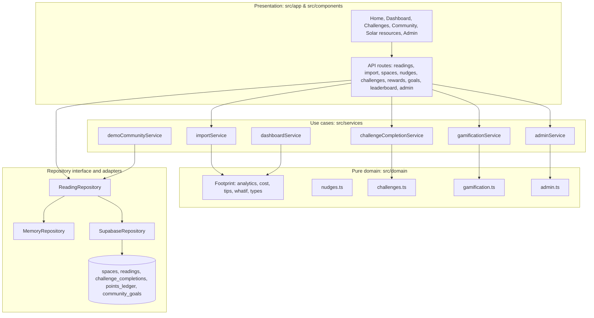

# WattWise ⚡

> **Know where your power goes.**

WattWise is an electricity usage tracking and intelligence web application designed for transparency, behavioral efficiency, and technical rigor. Electricity bills arrive once a month with a single aggregate number, obscuring daily consumption anomalies, the financial burden of high-draw appliances, and the associated carbon footprint. WattWise accepts daily meter readings through CSV or manual entry, detects usage spikes, translates kilowatt-hours into Indian Rupees (₹) and estimated grid CO₂ emissions, generates actionable behavioral recommendations, and lets users simulate habit changes with a what-if calculator.

---

## 🚀 Live Demo & 3-Step "Try It" Guide

**Live Demo URL:** `https://wattwise1.vercel.app`

To experience WattWise immediately without configuring any accounts or databases:
1. **Open the App:** Navigate to the home page or dashboard (`/dashboard`).
2. **Load Sample Data:** Click the **⚡ "Load 30-Day Sample Data"** button. The application ingests a curated 30-day screening dataset containing typical household baselines and 3 distinct spike days.
3. **Explore Intelligence:**
   - Review your daily usage chart with spike days flagged in high-contrast red/orange.
   - Adjust the **What-If Slider** (e.g. reduce AC usage by 1 hour/day) to observe real-time monthly financial and carbon savings.
   - Click **⚙️ Assumptions** to customize your state tariff (default ₹7/kWh) or spike detection threshold.

### Mission LiFE Communities & Rewards

The `/challenges` page provides daily self-reported micro-tasks. The `/community` page shows communities ranked by percent reduction against their configured baseline, community goal progress, points, streaks, and earned badges. Measured reading reductions are the primary points signal; self-reported actions earn fewer points and are capped daily. Until a resident baseline is configured, displayed scoring uses a labelled estimate.

Use **Load demo communities** on `/community` to create five synthetic communities and 30 days of readings, explicitly labelled **Demo data**. To seed through the running app from a terminal, run `npm run seed:demo-communities` (optionally set `WATTWISE_SITE_URL`). Apply both additive migrations in the documented order before using the new persistence features with Supabase.

### Administrator regional view

The `/admin` page reports aggregate-only community conservation for the latest 30 days. Configure a strong, private `ADMIN_KEY` environment variable on the server and enter the same value in the page; the browser sends it in the `x-admin-key` header and keeps it only in `sessionStorage` for that tab session. Do not configure it as a `NEXT_PUBLIC_` variable. If `ADMIN_KEY` is unset, the endpoint remains locked. CO₂ values and fallback baselines are labelled estimates; demo communities are explicitly labelled **Demo data**.

This shared-key gate is a minimal demonstration safeguard, not user or role-based authorization. Real role-based authentication, authorization, and administrator identity management are future work before production use.

### Data model and additive SQL

The base schema is `supabase/schema.sql`. Apply the additive migrations in order:
`supabase/20261031_challenge_completions.sql`, then
`supabase/20261101_gamification_community.sql`.
The challenge table uses `(profile_id, challenge_id, date)` as its primary key. The gamification migration adds `spaces.display_name`, `spaces.type`, `spaces.baseline_kwh_per_day`, and `spaces.people_count`; it creates `points_ledger` with primary key `(profile_id, date, source)` and `community_goals` with a space foreign key plus a valid date range. No extra admin table is needed because administrator reporting aggregates existing readings and challenge completions.

### API routes

Current product routes include:

| Method and path | Purpose |
|---|---|
| `GET/POST/DELETE /api/readings` | Read, write, and clear daily readings |
| `POST /api/import` | Validate and import CSV readings |
| `GET/POST /api/spaces` | List and create spaces, including baseline metadata |
| `GET /api/nudges` | Return contextual nudge suggestions |
| `GET /api/challenges`, `GET /api/challenges/today` | List/select available challenges and today's profile selection |
| `POST /api/challenges/complete` | Record a capped self-reported completion |
| `GET /api/me/rewards`, `GET /api/leaderboard` | Return personal rewards and community rankings |
| `GET/POST /api/goals` | Read and create community goals |
| `POST /api/communities/demo` | Seed clearly labelled demo communities |
| `GET /api/admin/summary` | Return administrator-only aggregates; requires `x-admin-key` |
| `POST /api/contact` | Submit contact form |

Every route uses the shared `withApi` wrapper for rate limiting, size checks, structured errors, and schema validation where configured.

---

## 🏛️ System Architecture

WattWise follows a strict **Layered Architecture** adhering to clean code and domain-driven design principles. A foundational architectural invariant is enforced: **no layer imports from a layer above it**.



### Mission LiFE mapping

WattWise is built for HC26-GEDA01; this is not a claim of official GEDA endorsement.

| HC26-GEDA01 core feature | What WattWise implements today | Evidence (implementation files) | Tests |
|---|---|---|---|
| Personalised footprint tracker | Daily usage dashboard, cost/CO₂ estimates, reading history, configurable space baseline. There is no separate onboarding flow yet; missing baselines use a labelled estimate. | `src/app/dashboard/page.tsx`, `src/app/api/readings/route.ts`, `src/app/api/spaces/route.ts`, `src/domain/analytics.ts`, `src/domain/cost.ts` | `tests/domain/analytics.test.ts`, `tests/domain/cost.test.ts`, `tests/services/dashboardService.test.ts`, `src/services/adminService.test.ts` |
| Behavioural nudges and micro-tasks | Contextual appliance nudges and deterministic daily challenge selection/completion. Nudges are scheduling advice based on the assumed peak window; the current API builds demo recent-reading context rather than reading hourly smart-meter data. | `src/domain/nudges.ts`, `src/domain/challenges.ts`, `src/app/api/nudges/route.ts`, `src/app/api/challenges/`, `src/services/challengeCompletionService.ts`, `src/components/NudgesCard.tsx`, `src/components/ChallengeBoard.tsx` | `src/domain/nudges.test.ts`, `src/domain/challenges.test.ts`, `src/services/challengeCompletionService.test.ts`, `src/infra/repository.contract.test.ts` |
| Gamification and social impact | Points, measured-reduction leaderboard, streaks, badges, community goals, and clearly labelled synthetic demo communities. Reading reductions are the primary validation signal; challenge actions are self-reported and capped. | `src/domain/gamification.ts`, `src/services/gamificationService.ts`, `src/services/demoCommunityService.ts`, `src/app/community/page.tsx`, `src/app/api/leaderboard/`, `src/app/api/goals/` | `src/domain/gamification.test.ts`, `src/services/gamificationService.test.ts`, `src/services/demoCommunityService.test.ts`, `src/infra/repository.contract.test.ts` |
| Actionable resource hub | Solar and official resource page links to government sources and gives a planning checklist. **A rooftop solar feasibility calculator is not currently implemented.** | `src/app/solar/page.tsx`, `src/components/Navbar.tsx`, `src/app/sitemap.ts` | No dedicated solar calculation tests because no calculator/business logic exists yet. |

Regional administrator aggregates are available at `/admin` and `GET /api/admin/summary`; evidence and tests are `src/services/adminService.ts`, `src/domain/admin.ts`, `src/app/api/admin/summary/route.ts`, `src/services/adminService.test.ts`, and `src/app/api/admin/summary/route.test.ts`.

### Architectural Flow & Boundaries

1. **`src/domain/` (Pure TypeScript):** Contains core business logic, metric calculations, and domain entities. It has zero framework imports and no I/O. `nudges.ts`, `challenges.ts`, `gamification.ts`, and `admin.ts` are pure domain modules; footprint logic is currently split across `analytics.ts`, `cost.ts`, `tips.ts`, and `whatif.ts`.
2. **`src/services/` (Use-Case Orchestration):** Coordinates domain models and validates external inputs. `importService.ts` normalizes CSV rows and implements deduplication policies; `dashboardService.ts` composes view models from raw series.
3. **`src/infra/` (Side Effects & Adapters):** Encapsulates storage and client-side processing. Database operations are strictly mediated through the `ReadingRepository` interface.
4. **`src/app/` & `src/components/` (Presentation):** React 19 UI styled with a high-contrast Neo-Brutalist design system.

---

## 🔑 Key Engineering Decisions

| Decision | Alternative Considered | Rationale |
| :--- | :--- | :--- |
| **Layered Architecture** | Feature-based folders | Decouples pure mathematical rules (cost, carbon, spike math) from framework specifics. Domain code can be ported to React Native, CLI, or microservices without modification. |
| **Repository Pattern** | Direct Supabase client in routes | Guarantees the screening demo **never breaks**. If Supabase credentials are missing, WattWise automatically activates the in-memory adapter seamlessly. |
| **Web Worker CSV Streaming** | Main-thread `Papa.parse` | Ingesting large electricity datasets (100k+ rows) blocks the browser event loop. Offloading parsing to an inline worker keeps the UI at 60 FPS while reporting real-time progress. |
| **Rule-Based Tips Engine** | LLM / Generative AI calls | Deterministic, instantaneous (&lt;1ms), zero API cost, completely offline, and auditable. Avoids hallucinated advice and latency during screening evaluations. |
| **Neo-Brutalist UI/UX** | Generic Shadcn / Tailwind template | Distinct visual identity with `#ffe17c` page yellow, `#171e19` charcoal, 2px solid black borders, and hard zero-blur drop shadows. Highly accessible with visible focus rings and motion safety. |

---

## 📈 Scalability & Growth Path

### 1. What Scales Today
- **Non-Blocking Ingestion:** Web Worker streaming processes 100,000+ CSV rows without dropping UI frames.
- **Client Chart Downsampling:** For datasets spanning multiple years (&gt;365 data points), `downsampleToWeekly()` aggregates readings into ISO weekly buckets, preventing SVG/Canvas DOM thrashing.
- **Batch Database Upserts:** `SupabaseRepository` breaks writes into 500-record chunks using Postgres `ON CONFLICT (space_id, date) DO UPDATE`.
- **Space Isolation:** Multi-tenancy is built into the schema from day one (`space_id`), supporting room, hostel block, or campus tracking.
- **API Defense:** In-memory sliding-window rate limiter protects endpoints from denial-of-service attempts.

### 2. What Changes at 10x Scale (10,000 Users / 10M Rows)
- **Database Partitioning:** Declaratively partition the `readings` table by year or quarter (`PARTITION BY RANGE (date)`).
- **Persistent Rate Limiting:** Swap the in-memory sliding-window counter for an Upstash Redis token bucket distributed across serverless edge handlers.
- **Read-Replica Caching:** Cache aggregated dashboard statistics (`SeriesStats`) in Redis with a 5-minute TTL, invalidating on new reading ingestion.

### 3. What Changes at 100x Scale & Smart-Meter / IoT Streaming
- **Batch Ingestion Pipeline:** Smart meters emitting 15-minute telemetry (96 readings/day/meter) post to an ingestion gateway backed by Apache Kafka or AWS Kinesis.
- **TimescaleDB / Hypertable Migration:** Convert PostgreSQL `readings` into a TimescaleDB hypertable with automated continuous aggregates (hourly, daily, weekly continuous rollups).
- **Edge Analytics:** Run spike detection and anomaly classification at the edge or gateway before persisting downsampled daily totals to the core database.

---

## 🧪 Testing Suite & Coverage

WattWise is comprehensively tested using **Vitest** with V8 code coverage.

### Running Tests

```bash
# Run all unit and contract tests
npm test

# Run tests in watch mode
npm run test:watch

# Generate code coverage report
npm run test:coverage

# Run TypeScript strict typecheck
npm run typecheck

# Run ESLint validation
npm run lint
```

Coverage changes as the code changes. Run `npm run test:coverage` for the current result; do not rely on historical coverage figures in reports.

Final quality-pass run: **154 passed, 8 skipped**. `src/domain`: **96.41% statements, 98.08% lines**. `src/services`: **96.75% statements, 97.48% lines**.

- **Analytics Edge Cases:** Validated on empty series, single readings, uniform values, trend directions, and weekly aggregations.
- **Conversion Safety:** Boundary and negative range checks on kWh, tariffs, and carbon coefficients.
- **CSV Robustness:** Missing headers, negative numbers, future dates, excessive rows, and duplicate resolutions (`latest`, `sum`, `average`).
- **Repository Invariant Contract:** Contract tests verifying CRUD, space isolation, pagination, and conflict upsert semantics on the repository interface.

---

## 🛠️ Setup & Local Development

### Prerequisites
- Node.js `v20.x` or `v24.x`
- npm `v10.x` or `v11.x`

### 1. Clone & Install
```bash
git clone https://github.com/your-username/wattwise.git
cd wattwise
npm install --legacy-peer-deps
```

### 2. Configure Environment (Optional)
Copy `.env.example` to `.env.local`:
```bash
cp .env.example .env.local
```
*(If left unset, WattWise runs in high-performance MemoryRepository mode automatically).*

### 3. Run Development Server
```bash
npm run dev
```
Open [http://localhost:3000](http://localhost:3000) to view WattWise.

---

## 🗄️ Supabase PostgreSQL Schema

If connecting to Supabase, execute the following script in the **Supabase SQL Editor**:

```sql
-- Create Spaces table (multi-space support)
CREATE TABLE IF NOT EXISTS spaces (
  id TEXT PRIMARY KEY,
  name TEXT NOT NULL,
  created_at TIMESTAMPTZ DEFAULT timezone('utc'::text, now()) NOT NULL
);

INSERT INTO spaces (id, name)
VALUES ('default', 'Main Space')
ON CONFLICT (id) DO NOTHING;

-- Create Readings table
CREATE TABLE IF NOT EXISTS readings (
  id BIGSERIAL PRIMARY KEY,
  space_id TEXT NOT NULL REFERENCES spaces(id) ON DELETE CASCADE,
  date DATE NOT NULL,
  kwh NUMERIC(8, 2) NOT NULL CHECK (kwh >= 0),
  created_at TIMESTAMPTZ DEFAULT timezone('utc'::text, now()) NOT NULL,
  updated_at TIMESTAMPTZ DEFAULT timezone('utc'::text, now()) NOT NULL,
  CONSTRAINT unique_space_date UNIQUE (space_id, date)
);

-- Index for high-speed date range lookups and pagination
CREATE INDEX IF NOT EXISTS idx_readings_space_date ON readings (space_id, date ASC);

-- Row Level Security policies for demo access
ALTER TABLE spaces ENABLE ROW LEVEL SECURITY;
ALTER TABLE readings ENABLE ROW LEVEL SECURITY;

CREATE POLICY "Allow public read access to spaces" ON spaces FOR SELECT USING (true);
CREATE POLICY "Allow public read access to readings" ON readings FOR SELECT USING (true);
CREATE POLICY "Allow public upsert access to readings" ON readings FOR ALL USING (true) WITH CHECK (true);
```

---

## Assumptions and limitations

- **Peak hours:** The default evening window is an assumption (`18:00–22:00`) in `src/lib/config.ts`; verify and configure it with the relevant DISCOM. The app stores daily readings, not hourly smart-meter telemetry, so peak-hour prompts are scheduling advice—not measured peak demand. The current nudge API also builds demo recent-reading context from profile/appliance inputs rather than loading observed history.
- **Baselines and footprint:** A space may store `baseline_kwh_per_day`; until configured, an explicitly labelled assumed baseline can be used. There is no dedicated onboarding workflow yet. Daily measured readings compared with the configured baseline are the validation signal for reduction points and community performance.
- **Points:** Measurement-derived reductions earn the primary points. Challenge completions are self-reported, earn fewer points, and are limited by per-completion weighting, 30 challenge points/day, and three completions/day by default. These are configurable program assumptions, not an official Mission LiFE scoring rule.
- **Demo data:** Seeded communities/readings are synthetic and must remain labelled **Demo data**. They do not represent real communities, vendors, prices, or measured impact.
- **Authentication and identity:** There is no resident login, role-based authorization, or secure profile identity yet. Challenge profile IDs are supplied by the UI/API (often demo/default IDs); they are not persisted in localStorage. The admin view uses a shared `ADMIN_KEY` in `sessionStorage` as a temporary demonstration gate, not production authentication.
- **Solar:** `/solar` links to official information and provides a planning checklist. A feasibility calculator and its configurable technical assumptions are not yet implemented; no solar output, cost, payback, or subsidy is claimed. No subsidy is hardcoded.
- **Tariff and emissions:** Sample tariff and grid-emissions factors are configurable estimates. Tariffs vary by state, DISCOM, and slab; emissions factors should be checked against the latest official CEA source before external claims.
- **Weather configuration:** `.env.example` lists `OPENWEATHER_API_KEY` as an optional server-side placeholder, but there is no weather feature consuming it in this release.

## Roadmap

1. Add resident accounts, durable profile ownership, and role-based administrator authorization.
2. Ingest hourly smart-meter readings to support measured peak-hour nudges.
3. Add DISCOM-specific tariff slabs with official source and version tracking.
4. Add opt-in push notifications for contextual nudges and challenges.
5. Build a verified rooftop-solar vendor directory and site-specific feasibility calculator; label estimates and make assumptions configurable, with no invented subsidy claims.
6. Add weather integration only after its product scope is defined; `OPENWEATHER_API_KEY` is currently unused.

---

## 📁 Project Directory Structure

```text
Wattwise/
├── .github/
│   └── workflows/
│       └── ci.yml               # GitHub Actions CI
├── docs/
│   └── REPORT.md                # Mission LiFE mapping, data model, rules, and report
├── public/
│   ├── logo.png
│   └── sample_data.csv          # Clearly labelled demo data
├── src/
│   ├── app/
│   │   ├── api/
│   │   │   ├── admin/summary/route.ts
│   │   │   ├── challenges/      # Catalog, today, and completion routes
│   │   │   ├── communities/demo/route.ts
│   │   │   ├── goals/route.ts
│   │   │   ├── import/route.ts
│   │   │   ├── nudges/route.ts
│   │   │   ├── readings/route.ts
│   │   │   └── spaces/route.ts
│   │   ├── admin/, challenges/, community/, dashboard/, solar/
│   │   ├── globals.css
│   │   ├── layout.tsx
│   │   ├── robots.ts
│   │   ├── sitemap.ts
│   │   └── page.tsx             # Landing and sample-data entrypoint
│   ├── components/
│   │   ├── AdminDashboard.tsx
│   │   ├── AdminTrendChart.tsx
│   │   ├── ChallengeBoard.tsx
│   │   ├── Footer.tsx
│   │   ├── HomePageContent.tsx
│   │   ├── Navbar.tsx
│   │   ├── NudgesCard.tsx
│   │   └── UsageChart.tsx
│   ├── domain/                  # Pure TypeScript business logic
│   │   ├── admin.ts
│   │   ├── analytics.ts         # Footprint, spikes, trends
│   │   ├── challenges.ts
│   │   ├── cost.ts
│   │   ├── gamification.ts
│   │   ├── nudges.ts
│   │   ├── tips.ts
│   │   ├── types.ts
│   │   └── whatif.ts
│   ├── infra/                   # Repository contract and adapters
│   ├── lib/                     # Zod env config, logger, rate limiter
│   └── services/                # Use-case orchestration and tests
├── supabase/
│   ├── schema.sql
│   ├── 20261031_challenge_completions.sql
│   └── 20261101_gamification_community.sql
├── scripts/
│   └── seed-demo-communities.mjs
├── .env.example
├── next.config.ts               # Security headers & Next config
├── package.json
├── tsconfig.json
└── vitest.config.ts
```

---

## 🔒 Security Configuration

In compliance with production security standards, `next.config.ts` enforces HTTP response security headers on all routes:
- **`Content-Security-Policy`**: Restricts script execution, fonts, and Supabase connections.
- **`X-Content-Type-Options`**: `nosniff` preventing MIME confusion.
- **`Referrer-Policy`**: `strict-origin-when-cross-origin`.
- **`X-Frame-Options`**: `DENY` protecting against clickjacking.
- **`frame-ancestors 'none'`**: Disallows embedding inside iframes.
