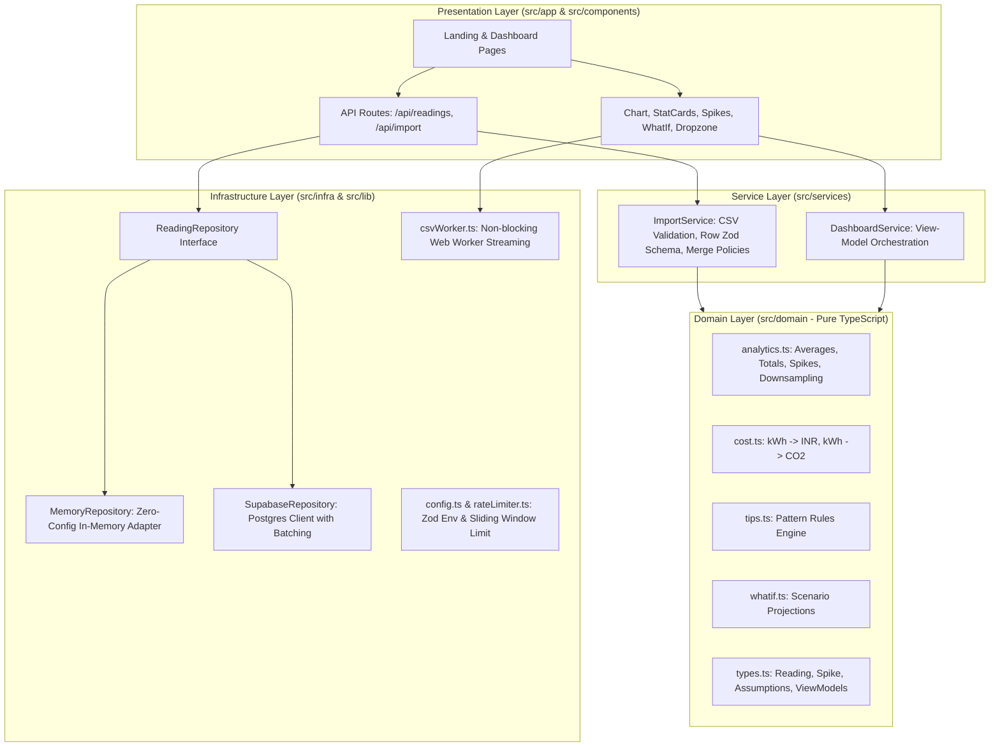

# WattWise ⚡

> **Know where your power goes.**

WattWise is an electricity usage tracking and intelligence web application designed for transparency, behavioral efficiency, and technical rigor. Electricity bills arrive once a month with a single aggregate number, obscuring daily consumption anomalies, the financial burden of high-draw appliances, and the associated carbon footprint. WattWise solves this by ingesting daily smart or manual readings, automatically detecting usage spikes, translating kilowatt-hours into Indian Rupees (₹) and grid CO₂ emissions, generating actionable behavioral recommendations, and empowering users to simulate habit changes through a live what-if calculator.

---

## 🚀 Live Demo & 3-Step "Try It" Guide

**Live Demo URL:** `https://wattwise1.vercel.app`

To experience WattWise immediately without configuring any accounts or databases:
1. **Open the App:** Navigate to the home page or dashboard (`/dashboard`).
2. **Load Sample Data:** Click the **⚡ "Load 30-Day Sample Data"** button. The application ingests a curated 30-day screening dataset containing typical household baselines and 3 distinct spike days.
3. **Explore Intelligence:**
   - Review your daily usage chart with spike days flagged in high-contrast red/orange.
   - Adjust the **What-If Slider** (e.g. reduce AC usage by 1 hour/day) to observe real-time monthly financial and carbon savings.
   - Click **⚙️ Assumptions** to customize your state tariff (default ₹7/kWh) or spike detection threshold.

---

## 🏛️ System Architecture

WattWise follows a strict **Layered Architecture** adhering to clean code and domain-driven design principles. A foundational architectural invariant is enforced: **no layer imports from a layer above it**.



### Architectural Flow & Boundaries

1. **`src/domain/` (Pure TypeScript):** Contains core business logic, metric calculations, and domain entities. It has zero external dependencies, zero framework imports (no React, no Next.js), zero I/O, and zero environment access. It is 100% unit tested in complete isolation.
2. **`src/services/` (Use-Case Orchestration):** Coordinates domain models and validates external inputs. `importService.ts` normalizes CSV rows and implements deduplication policies; `dashboardService.ts` composes view models from raw series.
3. **`src/infra/` (Side Effects & Adapters):** Encapsulates storage and client-side processing. Database operations are strictly mediated through the `ReadingRepository` interface.
4. **`src/app/` & `src/components/` (Presentation):** React 19 UI styled with a high-contrast Neo-Brutalist design system.

---

## 🔑 Key Engineering Decisions

| Decision | Alternative Considered | Rationale |
| :--- | :--- | :--- |
| **Layered Architecture** | Feature-based folders | Decouples pure mathematical rules (cost, carbon, spike math) from framework specifics. Domain code can be ported to React Native, CLI, or microservices without modification. |
| **Repository Pattern** | Direct Supabase client in routes | Guarantees the screening demo **never breaks**. If Supabase credentials are missing, WattWise automatically activates the in-memory adapter seamlessly. |
| **Web Worker CSV Streaming** | Main-thread `Papa.parse` | Ingesting large electricity datasets (100k+ rows) blocks the browser event loop. Offloading parsing to an inline worker keeps the UI at 60 FPS while reporting real-time progress. |
| **Rule-Based Tips Engine** | LLM / Generative AI calls | Deterministic, instantaneous (&lt;1ms), zero API cost, completely offline, and auditable. Avoids hallucinated advice and latency during screening evaluations. |
| **Neo-Brutalist UI/UX** | Generic Shadcn / Tailwind template | Distinct visual identity with `#ffe17c` page yellow, `#171e19` charcoal, 2px solid black borders, and hard zero-blur drop shadows. Highly accessible with visible focus rings and motion safety. |

---

## 📈 Scalability & Growth Path

### 1. What Scales Today
- **Non-Blocking Ingestion:** Web Worker streaming processes 100,000+ CSV rows without dropping UI frames.
- **Client Chart Downsampling:** For datasets spanning multiple years (&gt;365 data points), `downsampleToWeekly()` aggregates readings into ISO weekly buckets, preventing SVG/Canvas DOM thrashing.
- **Batch Database Upserts:** `SupabaseRepository` breaks writes into 500-record chunks using Postgres `ON CONFLICT (space_id, date) DO UPDATE`.
- **Space Isolation:** Multi-tenancy is built into the schema from day one (`space_id`), supporting room, hostel block, or campus tracking.
- **API Defense:** In-memory sliding-window rate limiter protects endpoints from denial-of-service attempts.

### 2. What Changes at 10x Scale (10,000 Users / 10M Rows)
- **Database Partitioning:** Declaratively partition the `readings` table by year or quarter (`PARTITION BY RANGE (date)`).
- **Persistent Rate Limiting:** Swap the in-memory sliding-window counter for an Upstash Redis token bucket distributed across serverless edge handlers.
- **Read-Replica Caching:** Cache aggregated dashboard statistics (`SeriesStats`) in Redis with a 5-minute TTL, invalidating on new reading ingestion.

### 3. What Changes at 100x Scale & Smart-Meter / IoT Streaming
- **Batch Ingestion Pipeline:** Smart meters emitting 15-minute telemetry (96 readings/day/meter) post to an ingestion gateway backed by Apache Kafka or AWS Kinesis.
- **TimescaleDB / Hypertable Migration:** Convert PostgreSQL `readings` into a TimescaleDB hypertable with automated continuous aggregates (hourly, daily, weekly continuous rollups).
- **Edge Analytics:** Run spike detection and anomaly classification at the edge or gateway before persisting downsampled daily totals to the core database.

---

## 🧪 Testing Suite & Coverage

WattWise is comprehensively tested using **Vitest** with V8 code coverage.

### Running Tests

```bash
# Run all unit and contract tests
npm test

# Run tests in watch mode
npm run test:watch

# Generate code coverage report
npm run test:coverage

# Run TypeScript strict typecheck
npm run typecheck

# Run ESLint validation
npm run lint
```

### Coverage Highlights

```text
 % Coverage report from v8
-------------------|---------|----------|---------|---------|
File               | % Stmts | % Branch | % Funcs | % Lines |
-------------------|---------|----------|---------|---------|
 domain/           |   89.8% |    82.9% |   91.4% |   91.5% |
  analytics.ts     |   96.5% |    85.0% |  100.0% |  100.0% |
  cost.ts          |  100.0% |   100.0% |  100.0% |  100.0% |
  whatif.ts        |  100.0% |   100.0% |  100.0% |  100.0% |
 services/         |  100.0% |    95.7% |  100.0% |  100.0% |
  dashboardService |  100.0% |   100.0% |  100.0% |  100.0% |
  importService    |  100.0% |    95.7% |  100.0% |  100.0% |
-------------------|---------|----------|---------|---------|
```

- **Analytics Edge Cases:** Validated on empty series, single readings, uniform values, trend directions, and weekly aggregations.
- **Conversion Safety:** Boundary and negative range checks on kWh, tariffs, and carbon coefficients.
- **CSV Robustness:** Missing headers, negative numbers, future dates, excessive rows, and duplicate resolutions (`latest`, `sum`, `average`).
- **Repository Invariant Contract:** Contract tests verifying CRUD, space isolation, pagination, and conflict upsert semantics on the repository interface.

---

## 🛠️ Setup & Local Development

### Prerequisites
- Node.js `v20.x` or `v24.x`
- npm `v10.x` or `v11.x`

### 1. Clone & Install
```bash
git clone https://github.com/your-username/wattwise.git
cd wattwise
npm install --legacy-peer-deps
```

### 2. Configure Environment (Optional)
Copy `.env.example` to `.env.local`:
```bash
cp .env.example .env.local
```
*(If left unset, WattWise runs in high-performance MemoryRepository mode automatically).*

### 3. Run Development Server
```bash
npm run dev
```
Open [http://localhost:3000](http://localhost:3000) to view WattWise.

---

## 🗄️ Supabase PostgreSQL Schema

If connecting to Supabase, execute the following script in the **Supabase SQL Editor**:

```sql
-- Create Spaces table (multi-space support)
CREATE TABLE IF NOT EXISTS spaces (
  id TEXT PRIMARY KEY,
  name TEXT NOT NULL,
  created_at TIMESTAMPTZ DEFAULT timezone('utc'::text, now()) NOT NULL
);

INSERT INTO spaces (id, name)
VALUES ('default', 'Main Space')
ON CONFLICT (id) DO NOTHING;

-- Create Readings table
CREATE TABLE IF NOT EXISTS readings (
  id BIGSERIAL PRIMARY KEY,
  space_id TEXT NOT NULL REFERENCES spaces(id) ON DELETE CASCADE,
  date DATE NOT NULL,
  kwh NUMERIC(8, 2) NOT NULL CHECK (kwh >= 0),
  created_at TIMESTAMPTZ DEFAULT timezone('utc'::text, now()) NOT NULL,
  updated_at TIMESTAMPTZ DEFAULT timezone('utc'::text, now()) NOT NULL,
  CONSTRAINT unique_space_date UNIQUE (space_id, date)
);

-- Index for high-speed date range lookups and pagination
CREATE INDEX IF NOT EXISTS idx_readings_space_date ON readings (space_id, date ASC);

-- Row Level Security policies for demo access
ALTER TABLE spaces ENABLE ROW LEVEL SECURITY;
ALTER TABLE readings ENABLE ROW LEVEL SECURITY;

CREATE POLICY "Allow public read access to spaces" ON spaces FOR SELECT USING (true);
CREATE POLICY "Allow public read access to readings" ON readings FOR SELECT USING (true);
CREATE POLICY "Allow public upsert access to readings" ON readings FOR ALL USING (true) WITH CHECK (true);
```

---

## Assumptions and limitations

1. **Grid Emission Factor:** The default is **`0.82 kg CO₂/kWh`**, labelled **“Approximate India grid average (configurable)”**. This is an approximation until verified against the latest CEA CO₂ Baseline Database. Change the default factor and its source label in `src/lib/config.ts`, or edit the factor in the dashboard Assumptions panel.
2. **Electricity Tariff:** Default baseline is set at **`₹7.00/kWh`**. In India, residential tariffs vary by state DISCOMs and tiered consumption slabs (e.g. ₹4.50 in Delhi, ₹6.50–₹8.50 in Karnataka and Maharashtra). Users can customize this via the UI Assumptions modal.
3. **Spike Detection Multiplier:** Default is set to **`1.5x`** the historical series average. Configurable in real time from `1.1x` to `3.0x`.
4. **Appliance Savings Models:**
   - 1.5-ton 3-star AC: ~1.5 kWh per hour of operation.
   - 25L Electric Storage Geyser: ~3.0 kW element (~0.05 kWh per minute).
   - Incandescent to 9W LED bulb: ~0.05 kWh/day saved per bulb (assuming 4 hours of use).
   - Standby power vampire load: ~0.015 kWh/day per device.

---

## 📁 Project Directory Structure

```text
Wattwise/
├── .github/
│   └── workflows/
│       └── ci.yml               # GitHub Actions CI (lint, typecheck, test, build)
├── public/
│   ├── logo.png                 # Official WattWise logo
│   └── sample_data.csv          # Curated 30-day screening dataset
├── src/
│   ├── app/
│   │   ├── api/
│   │   │   ├── import/route.ts  # Batch CSV import handler (rate limited)
│   │   │   └── readings/route.ts# REST endpoints (GET, POST, DELETE)
│   │   ├── dashboard/page.tsx   # Dashboard view orchestration
│   │   ├── globals.css          # Neo-Brutalist stylesheet and theme tokens
│   │   ├── layout.tsx           # Metadata, fonts, and favicon configuration
│   │   └── page.tsx             # Landing hero and sample data entrypoint
│   ├── components/
│   │   ├── AssumptionsPanel.tsx # Live parameter tuning modal
│   │   ├── EmptyState.tsx       # Zero-data CTA state
│   │   ├── Footer.tsx           # Branding & attribution footer
│   │   ├── ManualEntryModal.tsx # Single-day reading submission
│   │   ├── Navbar.tsx           # Top navigation with space switcher
│   │   ├── Skeletons.tsx        # Neo-Brutalist skeleton loaders
│   │   ├── SpikeList.tsx        # Anomaly listing with cost delta
│   │   ├── StatCards.tsx        # kWh, ₹, and CO2 KPI display
│   │   ├── TipCard.tsx          # Pattern-derived recommendations
│   │   ├── UploadDropzone.tsx   # Drag-and-drop CSV worker importer
│   │   ├── UsageChart.tsx       # Recharts graph with spike highlights
│   │   └── WhatIfSlider.tsx     # Habit simulation engine
│   ├── domain/                  # PURE TYPESCRIPT (No framework/IO imports)
│   │   ├── analytics.ts         # Math, spikes, downsampling, trends
│   │   ├── cost.ts              # Financial and carbon footprint math
│   │   ├── tips.ts              # Pattern rule engine
│   │   ├── types.ts             # Entities, interfaces, and defaults
│   │   └── whatif.ts            # Scenario projections
│   ├── infra/                   # STORAGE & HARDWARE ADAPTERS
│   │   ├── csvWorker.ts         # Web Worker streaming parser
│   │   ├── index.ts             # Repository provider/factory
│   │   ├── memoryRepository.ts  # In-memory demo store
│   │   ├── repository.ts        # Store interface contract
│   │   └── supabaseRepository.ts# Supabase Postgres client
│   ├── lib/
│   │   ├── config.ts            # Zod env schema & business constants
│   │   ├── logger.ts            # Structured server logger
│   │   └── rateLimiter.ts       # Sliding-window rate limiting
│   └── services/                # USE-CASE ORCHESTRATION
│       ├── dashboardService.ts  # Assembles view-models
│       └── importService.ts     # Validates & deduplicates CSV records
├── supabase/
│   └── schema.sql               # PostgreSQL tables, indexes & RLS SQL
├── tests/                       # UNIT & CONTRACT TESTS (Vitest)
│   ├── domain/
│   │   ├── analytics.test.ts
│   │   ├── cost.test.ts
│   │   ├── tips.test.ts
│   │   └── whatif.test.ts
│   ├── infra/
│   │   └── repositoryContract.test.ts
│   └── services/
│       ├── dashboardService.test.ts
│       └── importService.test.ts
├── .env.example
├── next.config.ts               # Security headers & Next config
├── package.json
├── tsconfig.json
└── vitest.config.ts
```

---

## 🔒 Security Configuration

In compliance with production security standards, `next.config.ts` enforces HTTP response security headers on all routes:
- **`Content-Security-Policy`**: Restricts script execution, fonts, and Supabase connections.
- **`X-Content-Type-Options`**: `nosniff` preventing MIME confusion.
- **`Referrer-Policy`**: `strict-origin-when-cross-origin`.
- **`X-Frame-Options`**: `DENY` protecting against clickjacking.
- **`frame-ancestors 'none'`**: Disallows embedding inside iframes.
