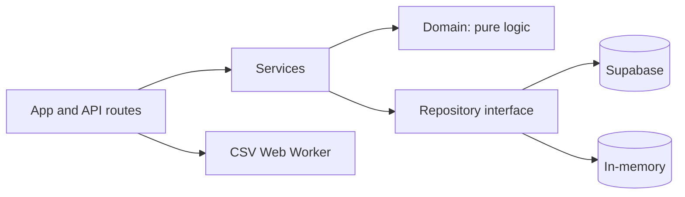

# WattWise: Project Report

**Hack Cult ’26 · Green Energy & Sustainability · Team Kalki**
Live: https://wattwise1.vercel.app · Code: https://github.com/harsh773988/Wattwise

> This report covers what the presentation could not. Before submitting, check every statement below against the actual repository (folder names, route names, test counts) and edit anything that differs.

## 1. Overview
WattWise helps people see where their electricity goes. Users add daily readings (CSV upload, manual entry, or one-click sample data) and get a usage chart, spike days, cost in rupees, CO₂ footprint, rule-based tips, and a what-if slider that projects monthly savings.

## 2. Problem and users
Electricity is visible to most households, hostels and campuses only as a monthly bill. That hides which days or habits caused the waste, and the carbon impact is never shown.
Target users: hostel residents sharing a bill, families, campus and office administrators.

## 3. Features
- Import: CSV (`date,kwh`), manual entry, sample data. Row-level validation with clear errors.
- Dashboard: total kWh, average per day, estimated cost, CO₂, spike days, daily chart.
- Tips: 3 to 5 rule-based tips from the user’s own pattern.
- What-if: choose a device (or custom watts) and hours saved per day; see monthly kWh, ₹ and CO₂ saved.
- Assumptions panel: tariff per kWh, emission factor, spike multiplier (all editable).
- Export and clear data, plus loading, empty and error states.

## 4. Architecture

Layers and rules:
- **domain/**: spike detection, cost, CO₂, tips, what-if. Pure TypeScript, no framework or I/O imports.
- **services/**: CSV import and the dashboard view-model, built only from domain functions.
- **infra/**: repository interface, Supabase adapter, in-memory adapter, CSV Web Worker.
- **app/**: pages, API route handlers, rate limiting, validation.
Dependencies point downward only, so storage can change without touching business logic. If Supabase variables are missing the app falls back to the in-memory adapter, so the demo never breaks.

## 5. Domain rules
- **Average** = total kWh ÷ number of days.
- **Spike day**: kWh above `spikeMultiplier × average` (default 1.5).
- **Cost** = kWh × tariff per kWh (default ₹7, user-editable).
- **CO₂ (kg)** = kWh × emission factor (default 0.82 kg/kWh, user-editable).
- **What-if saving** = device kW × hours saved per day × days in month.
- **Tips**: fixed rules (for example frequent spikes, high weekend usage, usage above a baseline), each with an estimated monthly kWh saving. Rule-based on purpose: explainable, testable, free to run.

## 6. Data and import
- CSV columns: `date` (ISO `YYYY-MM-DD`) and `kwh`; header matching is case-insensitive.
- Rejected rows: invalid or future dates, non-numeric or negative kWh, missing columns. Errors report row numbers.
- Duplicate dates are merged by summing kWh and the merge count is reported.
- Large files are parsed in a Web Worker in chunks with a progress indicator, so the UI stays responsive.
- Data model: `spaces(id, name)` and `readings(space_id, date, kwh)` with primary key `(space_id, date)` and an index on `(space_id, date)`. The schema supports several spaces (room, hostel block, campus) from day one.

## 7. API
- `GET/POST /api/readings`, `POST /api/import`, `GET/POST /api/spaces` (verify names in the repo).
- All inputs validated with zod. Errors use one format: `{ error: { code, message } }`.
- Per-IP rate limiting with `Retry-After` headers, request size limits, no stack traces in responses.

## 8. Scalability
Built now: Web Worker parsing for 100k+ rows, chart downsampling for large series, batched upserts, indexed and paginated reads, multi-space model, rate limiting.
Design notes (not built): batch ingestion endpoint for smart-meter data, time-series aggregation, caching, background queue for large imports, authentication with per-user spaces.

## 9. Testing and CI
- Vitest unit tests for domain and services (edge cases: empty series, single reading, equal values, threshold boundaries, rounding).
- Repository contract tests run against the in-memory adapter (and Supabase when configured).
- API handler tests and key component tests.
- GitHub Actions runs lint, typecheck, tests and build on every push.
- Coverage: *[add the number from `npm test -- --coverage`]*.

## 10. Security and privacy
- Security headers: Content-Security-Policy, X-Content-Type-Options, Referrer-Policy, frame-ancestors, Permissions-Policy.
- Secrets only in environment variables; `.env.example` holds placeholders.
- Server-side validation on every route; honeypot and rate limit on the contact form.
- Analytics (if enabled) is consent-gated and never receives reading data.

## 11. UI/UX and accessibility
Neo-Brutalist style (yellow, charcoal, sage; 2px borders; hard shadows). Mobile-first layout, keyboard-operable controls, visible focus, reduced-motion support, loading skeletons, empty states and toast feedback.

## 12. Assumptions and limitations
- The CO₂ factor is an approximation of the India grid average and is editable. Confirm the value against the latest CEA CO₂ Baseline Database before quoting a source.
- Tariffs differ by state and slab; the user sets their own.
- Tips and savings are estimates, not measurements.
- No user accounts in this version; with the in-memory adapter, data resets on server restart.

## 13. Impact simulation (slide 5)
Method: take the bundled `sample_data.csv` (30 days). Scenario A: spike days are brought back to 1.1 × the non-spike average. Scenario B: A plus 1 hour less of an assumed 1.5 kW AC per day (1.5 kWh/day).

| Scenario | Monthly kWh | Cost at ₹7/kWh | CO₂ at 0.82 kg/kWh |
|---|---|---|---|
| Before | 223.0 | ₹1,561 | 182.9 kg |
| A: spikes normalised | 208.1 | ₹1,457 | 170.6 kg |
| B: A + 1 h less AC | 163.1 | ₹1,142 | 133.7 kg |

Saving for B: about 60 kWh (27%), ₹419 and 49 kg CO₂ per month. This is a simulation on sample data, not a measured result.

## 14. Feasibility and roadmap
- Technical: built, deployed and tested; runs in the browser from a CSV with no hardware.
- Economic: the prototype runs on free tiers.
- Operational: one-click sample data, mobile friendly.
- Roadmap: user accounts and per-hostel spaces, smart-meter import, campus-wide carbon reports and alerts.

## 15. References
- CEA CO₂ Baseline Database, cea.nic.in (confirm latest version)
- Bureau of Energy Efficiency, beeindia.gov.in
- W3C WCAG 2.2, w3.org/TR/WCAG22
- OWASP Secure Headers Project, owasp.org/www-project-secure-headers
- MDN Web Workers API, developer.mozilla.org/en-US/docs/Web/API/Web_Workers_API
- Documentation: Next.js, React, TypeScript, Tailwind CSS, Supabase, Recharts, PapaParse, Zod, Vitest, Vercel

## 16. Team
Team Kalki: Harsh Kumar, Akash Kumar, Misha Kumari, Hazra Parween.
