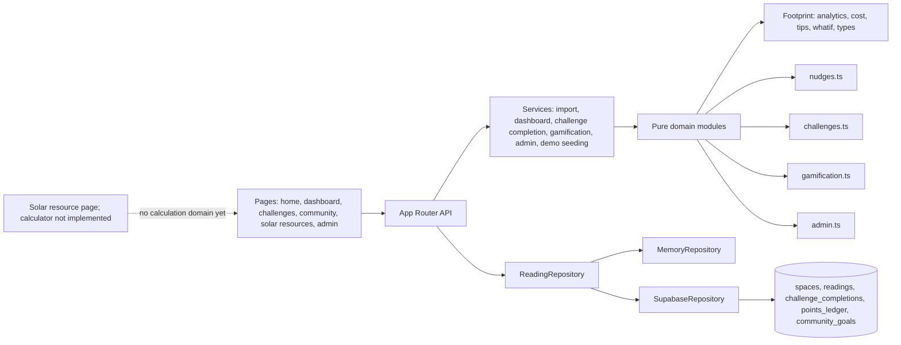

# WattWise: Mission LiFE Project Report

**Hack Cult ’26 · Green Energy & Sustainability · Problem statement HC26-GEDA01 · Team Kalki**
Live demo: https://wattwise1.vercel.app · Repository: https://github.com/harsh773988/Wattwise

WattWise is a personal and community electricity-use companion. It accepts daily readings through CSV, manual entry, or clearly labelled demo data, then presents consumption patterns, baseline comparisons, estimated costs and emissions, behavioral suggestions, challenges, rewards, community goals, and regional aggregates.

WattWise is built for the stated problem; this report does not imply official GEDA endorsement.

## 1. HC26-GEDA01 feature mapping

| Core feature | Current implementation and scope | Evidence | Tests |
|---|---|---|---|
| Personalised footprint tracker | Daily usage dashboard, reading history, cost/CO₂ estimates, and configurable space baseline. There is not yet a dedicated onboarding flow; a missing baseline can use a labelled estimate. | `src/app/dashboard/page.tsx`, `src/app/api/readings/route.ts`, `src/app/api/spaces/route.ts`, `src/domain/analytics.ts`, `src/domain/cost.ts` | `tests/domain/analytics.test.ts`, `tests/domain/cost.test.ts`, `tests/services/dashboardService.test.ts` |
| Behavioural nudges and micro-tasks | Appliance-aware scheduling advice and daily challenge selection/completion. Nudges use assumed peak hours and daily data; there is no hourly smart-meter measurement. The nudge endpoint currently uses demo recent-reading context derived from profile/appliance request inputs, not stored readings. | `src/domain/nudges.ts`, `src/domain/challenges.ts`, `src/app/api/nudges/route.ts`, `src/app/api/challenges/`, `src/services/challengeCompletionService.ts` | `src/domain/nudges.test.ts`, `src/domain/challenges.test.ts`, `src/services/challengeCompletionService.test.ts`, `src/infra/repository.contract.test.ts` |
| Gamification and social impact | Measurement-derived points, percent-reduction rankings, streaks, badges, goals, and synthetic communities marked Demo data. Challenge actions are self-reported, earn fewer points, and are capped. | `src/domain/gamification.ts`, `src/services/gamificationService.ts`, `src/services/demoCommunityService.ts`, `src/app/community/page.tsx` | `src/domain/gamification.test.ts`, `src/services/gamificationService.test.ts`, `src/services/demoCommunityService.test.ts`, `src/infra/repository.contract.test.ts` |
| Actionable resource hub | `/solar` contains official links and a checklist. A rooftop solar feasibility calculator is **not implemented**; no solar output, cost, payback, or subsidy is claimed. | `src/app/solar/page.tsx`, `src/components/Navbar.tsx`, `src/app/sitemap.ts` | No solar calculation tests exist because there is no calculation logic. |

Administrator aggregates are served by `GET /api/admin/summary` and rendered at `/admin`. The output is aggregate-only and the route is protected by a shared demonstration key. Evidence: `src/services/adminService.ts`, `src/domain/admin.ts`, `src/app/api/admin/summary/route.ts`. Tests: `src/services/adminService.test.ts`, `src/app/api/admin/summary/route.test.ts`.

## 2. Architecture



`src/domain/` is framework-free business logic. `src/services/` orchestrates use cases. `src/infra/` contains the repository contract and both adapters. `src/app/` and `src/components/` provide routes and UI. In-memory storage remains available when Supabase is not configured.

## 3. Data model and SQL

The base schema is `supabase/schema.sql`. Apply additive migrations in order:

1. `supabase/20261031_challenge_completions.sql`
2. `supabase/20261101_gamification_community.sql`

The core model is `spaces(id, name, created_at)` and `readings(space_id, date, kwh, created_at)` with reading primary key `(space_id, date)`. The gamification migration adds `spaces.display_name`, `spaces.type` (`room`, `hostel`, `society`, or `campus`), `spaces.baseline_kwh_per_day`, and `spaces.people_count`.

```sql
CREATE TABLE IF NOT EXISTS challenge_completions (
  profile_id TEXT NOT NULL,
  challenge_id TEXT NOT NULL,
  date DATE NOT NULL,
  points_awarded INTEGER NOT NULL DEFAULT 0,
  created_at TIMESTAMPTZ NOT NULL DEFAULT NOW(),
  PRIMARY KEY (profile_id, challenge_id, date)
);

CREATE TABLE IF NOT EXISTS points_ledger (
  profile_id TEXT NOT NULL,
  date DATE NOT NULL,
  source TEXT NOT NULL,
  points INTEGER NOT NULL CHECK (points >= 0),
  reason TEXT NOT NULL,
  created_at TIMESTAMPTZ NOT NULL DEFAULT NOW(),
  PRIMARY KEY (profile_id, date, source)
);

CREATE TABLE IF NOT EXISTS community_goals (
  id TEXT PRIMARY KEY,
  space_id TEXT NOT NULL REFERENCES spaces(id) ON DELETE CASCADE,
  target_percent NUMERIC NOT NULL CHECK (target_percent >= 0 AND target_percent <= 100),
  period_start DATE NOT NULL,
  period_end DATE NOT NULL,
  created_at TIMESTAMPTZ NOT NULL DEFAULT NOW(),
  CHECK (period_start <= period_end)
);
```

The repository interface exposes these records for both Supabase and in-memory operation. No new administrator table is required: reporting aggregates existing readings and challenge-completion records.

## 4. API surface

All routes use `withApi` for rate limiting, request-size guards, common error handling, and Zod validation where applicable.

| Method and route | Purpose |
|---|---|
| `GET/POST/DELETE /api/readings` | Read, write, and clear daily readings |
| `POST /api/import` | Validate and import CSV readings |
| `GET/POST /api/spaces` | List and create spaces and baseline metadata |
| `GET /api/nudges` | Return contextual nudge suggestions |
| `GET /api/challenges` and `GET /api/challenges/today` | Return challenge catalog and daily selection |
| `POST /api/challenges/complete` | Record a capped self-reported completion |
| `GET /api/me/rewards` | Return the selected profile’s rewards |
| `GET /api/leaderboard` | Return community rankings |
| `GET/POST /api/goals` | Read and create community goals |
| `POST /api/communities/demo` | Seed synthetic communities, labelled Demo data |
| `GET /api/admin/summary` | Return regional aggregates; requires `x-admin-key` |
| `POST /api/contact` | Submit a contact message |

## 5. Points and validation rules

The current configured values are assumptions in `src/lib/config.ts`, not official program rules. Actual daily reading reductions compared with a baseline are the validation signal and primary points source. Challenge completion is self-reported, secondary, and capped.

| Rule | Current default |
|---|---|
| Measured reduction points | `floor(percentReduction × 2)`; maximum 100 points/day |
| Under-baseline streak bonus | 5 points per consecutive day; maximum 25/day |
| Self-reported challenge award | `floor(challengeCatalogPoints × 0.4)` per completion |
| Challenge completion limit | At most 3 per profile/day |
| Self-reported challenge-points cap | At most 30 per profile/day |
| Community ranking | Percent reduction against baseline; stable tie-breaks |

Rules and badge thresholds are tested in `src/domain/gamification.test.ts` and `src/services/challengeCompletionService.test.ts`.

## 6. Assumptions, limitations, and privacy

- **Peak-hour nudges:** Default assumed window `18:00–22:00`; verify against the relevant DISCOM. Daily readings cannot identify actual hourly peaks. Nudge messages are scheduling suggestions, not smart-meter measurements; current API context is demo-generated.
- **Footprint baseline:** No dedicated onboarding flow exists yet. The user-facing space can have a `baseline_kwh_per_day`; otherwise the fallback is explicitly labelled as an estimate.
- **Points:** Measured readings against baseline are the primary validation; self-reported challenges are secondary and capped as shown above.
- **Demo content:** Synthetic seeded readings and communities must be presented as **Demo data**. They do not represent real organisations or performance.
- **Identity and authorization:** There is no resident login or role-based authorization. Profile IDs are supplied through UI/API defaults and are not persisted in localStorage. The shared `ADMIN_KEY` is held in browser `sessionStorage` and sent in the `x-admin-key` header; this is a demo gate, not production authentication.
- **Solar:** The resource page does not calculate feasibility. There are no solar output/cost assumptions or subsidy claims in the product. Verify official links before demo/submission; any future calculator values must be labelled estimates and assumptions made configurable.
- **Tariff and emissions:** Defaults are configurable estimates. DISCOM slabs and grid-emissions factors require official-source verification before being represented as authoritative.
- **Weather:** `OPENWEATHER_API_KEY` is an optional server-side placeholder only; no current feature reads it.
- **Storage:** In-memory data resets when the server restarts. Supabase RLS policies are suitable only for this demo until real authorization is designed.

## 7. Roadmap

1. Real resident accounts, profile ownership, and role-based administrator authorization.
2. Hourly smart-meter ingestion to enable measured peak-hour nudges and stronger validation.
3. DISCOM-specific tariff slabs and bill calculations, with source/version tracking.
4. Opt-in push notifications for timely nudges and challenges.
5. Verified, maintained rooftop-solar vendor directory and a site-specific solar feasibility calculator, with configurable assumptions and no invented subsidy claims.
6. Only after a weather feature is specified: integrate the optional OpenWeather key server-side.

## 8. Verification

Final quality-pass results: `npm test -- --coverage` ran **154 tests passed and 8 skipped**. `src/domain` coverage: **96.41% statements and 98.08% lines**. `src/services` coverage: **96.75% statements and 97.48% lines**. `npm run typecheck` and `npm run build` passed. `npm run lint` passed with one existing warning in `postcss.config.mjs`.

## 9. Manual submission checklist

- Configure private `ADMIN_KEY` on Vercel. `OPENWEATHER_API_KEY` is not currently consumed; configure it only if/when weather integration is added.
- Apply the two additive Supabase migrations above after the base schema.
- Verify the official solar resource URLs and verify every peak-hour, tariff, emissions, and future solar assumption against an authoritative source.
- Redeploy, then update the presentation and demo video to match implemented behavior and disclosed limitations.
