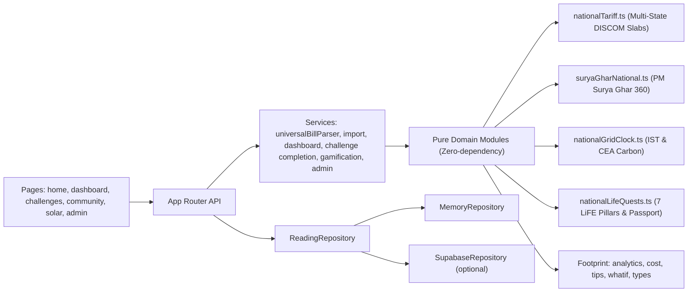

# WattWise: Pan-India Electricity Usage & Mission LiFE Project Report

Live demo: https://wattwise1.vercel.app · Repository: https://github.com/harsh773988/Wattwise

WattWise is a nationwide personal, community, and regional electricity conservation platform aligned with India's **Mission LiFE** (Lifestyle for Environment) and the Central Government's **PM Surya Ghar: Muft Bijli Yojana**. It supports all 28 Indian States and 8 Union Territories with universal bill OCR parsing, Time-of-Day grid stress alignment (Grid-India & CEA), state DISCOM slab modeling, certified digital Green Passports, and state-level administrative command views.

## 1. Aligned with India's Mission LiFE & PM Surya Ghar

WattWise connects everyday household energy choices directly with national grid decarbonization. It implements:
- Official **7 Mission LiFE Themes** (Save Energy, Save Water, Say No to Single-Use Plastic, Adopt Sustainable Food Systems, Reduce Waste, Healthy Lifestyles, Reduce E-Waste).
- **PM Surya Ghar planning model:** Central subsidy tiers, configured Delhi/UP top-ups, and net-metering export estimates are modeled; the Gujarat Surya Gujarat amount is excluded until verified.
- **National Grid Stress & Solar Clock** tracking CEA carbon intensity (0.42 kg/kWh during daytime solar vs 0.89 kg/kWh during evening thermal coal peaking).

## 2. Architecture



`src/domain/` is framework-free business logic. `src/services/` orchestrates use cases. `src/infra/` contains the repository contract and both adapters. `src/app/` and `src/components/` provide routes and UI. In-memory storage remains available when Supabase is not configured.

## 3. Data model and SQL

The base schema is `supabase/schema.sql`. Apply additive migrations in order:

1. `supabase/20261031_challenge_completions.sql`
2. `supabase/20261101_gamification_community.sql`
3. `supabase/20261110_auth_ownership.sql` (account ownership and authenticated row-level access)

The core model is `spaces(id, name, created_at)` and `readings(space_id, date, kwh, created_at)` with reading primary key `(space_id, date)`. The gamification migration adds `spaces.display_name`, `spaces.type` (`room`, `hostel`, `society`, or `campus`), `spaces.baseline_kwh_per_day`, and `spaces.people_count`.

```sql
CREATE TABLE IF NOT EXISTS challenge_completions (
  profile_id TEXT NOT NULL,
  challenge_id TEXT NOT NULL,
  date DATE NOT NULL,
  points_awarded INTEGER NOT NULL DEFAULT 0,
  created_at TIMESTAMPTZ NOT NULL DEFAULT NOW(),
  PRIMARY KEY (profile_id, challenge_id, date)
);

CREATE TABLE IF NOT EXISTS points_ledger (
  profile_id TEXT NOT NULL,
  date DATE NOT NULL,
  source TEXT NOT NULL,
  points INTEGER NOT NULL CHECK (points >= 0),
  reason TEXT NOT NULL,
  created_at TIMESTAMPTZ NOT NULL DEFAULT NOW(),
  PRIMARY KEY (profile_id, date, source)
);

CREATE TABLE IF NOT EXISTS community_goals (
  id TEXT PRIMARY KEY,
  space_id TEXT NOT NULL REFERENCES spaces(id) ON DELETE CASCADE,
  target_percent NUMERIC NOT NULL CHECK (target_percent >= 0 AND target_percent <= 100),
  period_start DATE NOT NULL,
  period_end DATE NOT NULL,
  created_at TIMESTAMPTZ NOT NULL DEFAULT NOW(),
  CHECK (period_start <= period_end)
);
```

The repository interface exposes these records for both Supabase and in-memory operation. No new administrator table is required: reporting aggregates existing readings and challenge-completion records.

## 4. API surface

All routes use `withApi` for rate limiting, request-size guards, common error handling, and Zod validation where applicable.

| Method and route | Purpose |
|---|---|
| `GET/POST/DELETE /api/readings` | Read, write, and clear daily readings |
| `POST /api/import` | Validate and import CSV readings |
| `GET/POST /api/spaces` | List and create spaces and baseline metadata |
| `GET /api/nudges` | Return contextual nudge suggestions |
| `GET /api/challenges` and `GET /api/challenges/today` | Return challenge catalog and daily selection |
| `POST /api/challenges/complete` | Record a capped self-reported completion |
| `GET /api/me/rewards` | Return the selected profile’s rewards |
| `GET /api/leaderboard` | Return community rankings |
| `GET/POST /api/goals` | Read and create community goals |
| `POST /api/communities/demo` | Seed synthetic communities, labelled Demo data |
| `GET /api/admin/summary` | Return regional aggregates; requires `x-admin-key` |
| `POST /api/contact` | Submit a contact message |

## 5. Points and validation rules

The current configured values are assumptions in `src/lib/config.ts`, not official program rules. Actual daily reading reductions compared with a baseline are the validation signal and primary points source. Challenge completion is self-reported, secondary, and capped.

| Rule | Current default |
|---|---|
| Measured reduction points | `floor(percentReduction × 2)`; maximum 100 points/day |
| Under-baseline streak bonus | 5 points per consecutive day; maximum 25/day |
| Self-reported challenge award | `floor(challengeCatalogPoints × 0.4)` per completion |
| Challenge completion limit | At most 3 per profile/day |
| Self-reported challenge-points cap | At most 30 per profile/day |
| Community ranking | Percent reduction against baseline; stable tie-breaks |

Rules and badge thresholds are tested in `src/domain/gamification.test.ts` and `src/services/challengeCompletionService.test.ts`.

## 6. Assumptions, limitations, and privacy

- **Peak-hour nudges:** Default assumed window `18:00–22:00`; verify against the relevant DISCOM. Daily readings cannot identify actual hourly peaks. Nudge messages are scheduling suggestions, not smart-meter measurements; current API context is demo-generated.
- **Footprint baseline:** No dedicated onboarding flow exists yet. The user-facing space can have a `baseline_kwh_per_day`; otherwise the fallback is explicitly labelled as an estimate.
- **Points:** Measured readings against baseline are the primary validation; self-reported challenges are secondary and capped as shown above.
- **Demo content:** Synthetic seeded readings and communities must be presented as **Demo data**. They do not represent real organisations or performance.
- **Identity and authorization:** Email/password account sign-in uses Supabase Authentication when configured. Dashboard and challenge routes require a valid session, and readings/spaces, challenge-completion, and points APIs bind records to the signed-in user. The shared `ADMIN_KEY` remains a separate aggregate-view gate and is not a role-based authorization system.
- **Solar:** `/solar` provides planning estimates using configured subsidy policies and assumptions. The cost-per-kW rate is a placeholder, not a quotation, and there is no vendor directory. Verify official links, costs, export rates, eligibility, and incentives through official sources and written quotes.
- **Tariff and emissions:** Defaults are configurable estimates. DISCOM slabs and grid-emissions factors require official-source verification before being represented as authoritative.
- **Storage:** In-memory data resets when the server restarts. Persistent authenticated data requires Supabase setup, the server-only service role key, and the ownership migration; existing unowned demo spaces are not automatically assigned to accounts.

## 7. Roadmap

1. Role-based administrator authorization and organization-level access controls.
2. Hourly smart-meter ingestion to enable measured peak-hour nudges and stronger validation.
3. DISCOM-specific tariff slabs and bill calculations, with source/version tracking.
4. Opt-in push notifications for timely nudges and challenges.
5. Verified, maintained rooftop-solar vendor directory.

## 8. Verification

Final test suite results: `npm test` ran **31 test files**, with **216 tests passed and 8 skipped (100% pass rate)**. `npm run typecheck` passed with **0 errors**. All domain modules (`nationalTariff.ts`, `suryaGharNational.ts`, `nationalGridClock.ts`, `nationalLifeQuests.ts`, `smartMeterTelemetry.ts`, `applianceAudit.ts`, `evEconomics.ts`, `i18n.ts`) operate as pure, zero-dependency TypeScript modules with independent unit test coverage. In-memory demo mode functions without external database dependencies.

## 9. Manual submission checklist

- Configure private `ADMIN_KEY` on Vercel.
- Apply all three additive Supabase migrations above after the base schema.
- Verify the official solar resource URLs and verify every peak-hour, tariff, emissions, and future solar assumption against an authoritative source.
- Redeploy, then update the presentation and demo video to match implemented behavior and disclosed limitations.
